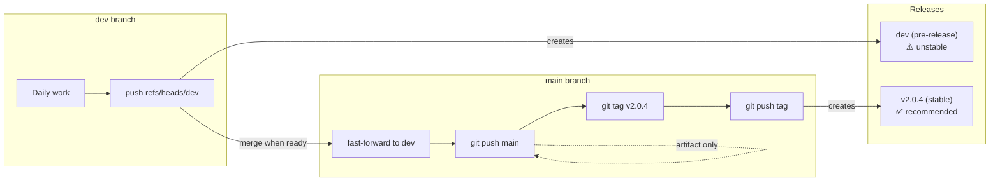

# Developer Workflow Guide

This guide explains the branching, tagging, and release workflow for this project — including if you fork it. The GitHub Actions workflow is included, so your fork will automatically build and release bundles when you push to `dev` or tag a version.

## Branches

| Branch | Purpose |
|--------|---------|
| `dev` | Active development, can be unstable |
| `main` | Stable, tested code ready for release |

`dev` is also a tag: the Development Build release's tag, which the workflow moves to each commit pushed to the `dev` branch. In a git command that takes a ref, a bare `dev` can mean the tag rather than the branch: `git merge dev` can merge the tag's commit, and `git push origin dev` fails with `src refspec dev matches more than one`. So every command below that names the branch writes `refs/heads/dev`, and `git switch dev` checks it out. A clone keeps the tag where it first fetched it; refresh it with `git fetch origin --force refs/tags/dev:refs/tags/dev`.

## Daily Development (on `dev` branch)

```bash
# You're on dev, making changes
git switch dev

# Edit files, test locally...

# Commit and push
git add -A && git commit -m "feat: add cool feature"
git push origin refs/heads/dev:refs/heads/dev
```

**What happens automatically:**
- Bundle workflow runs → creates artifacts:
  - `open_webui_openrouter_pipe_bundled.py` (readable)
  - `open_webui_openrouter_pipe_bundled_compressed.py` (compressed)
  - `open_webui_openrouter_pipe_bundled_no_plugins.py` (readable, plugins omitted)
  - `open_webui_openrouter_pipe_bundled_compressed_no_plugins.py` (compressed, plugins omitted)
- Moves the `dev` tag to the pushed commit and updates the `dev` pre-release with the new bundle
- Bleeding-edge users can download from the `dev` release

---

## Releasing a New Version

Before tagging, commit the version bump on `dev`. The version lives in four places:

- `open_webui_openrouter_pipe.py` manifest header: the `version:` field and the tag in the `requirements:` release-archive URL (`.../archive/refs/tags/vX.Y.Z.zip`)
- `pyproject.toml`: `version`
- `open_webui_openrouter_pipe/__init__.py`: `_FALLBACK_VERSION`
- `README.md`: the version badge

Regenerate the changelog before tagging: `git cliff --tag v2.0.4 -o CHANGELOG.md` (git-cliff, configured by `cliff.toml`).

The release notes open with the text of `RELEASE_NOTES_PENDING.md`, the running list of user-facing changes since the previous release, followed by the list of commits since the previous tag. When the two together would not fit in a GitHub release, the notes become a link to the file as it stands at the tag. After the tag is pushed, empty the file down to its `# Release notes pending` heading in the next commit on `dev`, so the next release starts from its own changes.

```bash
# 1. Fast-forward main to dev
git switch main
git pull --ff-only                    # Get latest main
git merge --ff-only refs/heads/dev    # main takes exactly dev's commits
git push origin refs/heads/main:refs/heads/main   # Push to main (no release created)

# 2. Create version tag
git tag v2.0.4                        # Create tag
git rev-parse v2.0.4 refs/heads/main refs/heads/dev   # all three must print the same commit
git push origin refs/tags/v2.0.4      # Push tag
# → This creates the v2.0.4 release automatically, with notes listing the commits since the previous tag

# 3. Go back to dev for next work
git switch dev
# Empty RELEASE_NOTES_PENDING.md down to its heading, commit, push
```

---

## Visual Flow



---

## What Each Thing Is For

| Concept | Purpose | URL |
|---------|---------|-----|
| **dev branch** | Your working area, can be messy | Updates `dev` pre-release |
| **main branch** | Stable, tested code (staging for tags) | Artifact only |
| **Tags (v2.0.4)** | Permanent version markers | Creates versioned release |
| **dev release** | "Bleeding edge" for adventurous users; its `dev` tag follows the `dev` branch | `.../download/dev/...` |
| **v2.0.4 release** | Stable version for most users | `.../releases/latest/download/...` |

---

## Quick Reference

```bash
# Daily work
git switch dev
# ... edit, commit, push ...
git push origin refs/heads/dev:refs/heads/dev     # → moves the dev tag, updates "dev" pre-release

# Ready to release (version bump and changelog already committed on dev)
git switch main && git merge --ff-only refs/heads/dev && git push origin refs/heads/main:refs/heads/main   # → artifact only
git tag v2.0.4 && git rev-parse v2.0.4 refs/heads/main refs/heads/dev   # → all three the same commit
git push origin refs/tags/v2.0.4                   # → creates v2.0.4 release
git switch dev                                     # then empty RELEASE_NOTES_PENDING.md down to its heading

# Hotfix on main (rare)
git switch main
# ... fix bug ...
git push origin refs/heads/main:refs/heads/main    # → artifact only
git tag v2.0.5 && git push origin refs/tags/v2.0.5  # → creates v2.0.5 release
git switch dev && git merge refs/heads/main        # → bring the fix into dev
```

---

## Download URLs

### For Users

```
# Stable (recommended for most users) — auto-resolves to latest tagged release:
https://github.com/rbb-dev/Open-WebUI-OpenRouter-pipe/releases/latest/download/open_webui_openrouter_pipe_bundled.py

# Stable (compressed, same behavior but smaller + less clutter in the editor):
https://github.com/rbb-dev/Open-WebUI-OpenRouter-pipe/releases/latest/download/open_webui_openrouter_pipe_bundled_compressed.py

# Development build (bleeding edge, may be unstable):
https://github.com/rbb-dev/Open-WebUI-OpenRouter-pipe/releases/download/dev/open_webui_openrouter_pipe_bundled.py

# Development build (compressed):
https://github.com/rbb-dev/Open-WebUI-OpenRouter-pipe/releases/download/dev/open_webui_openrouter_pipe_bundled_compressed.py
```

### For Developers (Artifacts)

Go to **Actions** → select a workflow run → scroll to **Artifacts** → download the `.zip` file.

---

## Linting

Production code is linted with [ruff](https://docs.astral.sh/ruff/) in CI. The rule set is ruff's own default, so the version matters: `pyproject.toml` sets `required-version` to match the pin in .github/workflows/verify.yml, and a different ruff refuses to run rather than reporting findings CI would not.

```bash
source .venv/bin/activate && ruff check open_webui_openrouter_pipe/ scripts/ filters/
```

Tests (`tests/`) are **not** linted — patterns like mid-file imports, fixture redefinitions, and assign-to-verify are intentional and would trigger false positives.

> **Warning:** Do not use `ruff --fix`. It cannot detect re-exports and will silently remove imports that other modules depend on. Fix issues manually.

## Prose in production code

The package, `scripts/anyio_1111_workaround.py` and the root manifest carry no comments and no docstrings. The comments that remain are tool directives (`# noqa`, `# type: ignore`, `# pyright: ignore`, `# pragma: no cover`, `# fmt:`) with nothing after them, and the manifest keeps the `key: value` frontmatter lines that Open WebUI and the bundler read. Apart from the frontmatter header and the same tool directives, the bundler emits no comments or docstrings into the bundles.

CI and `scripts/gate.sh` run the check:

```bash
source .venv/bin/activate && python scripts/strip_prose.py --check
```

It prints each file and line that carries prose and exits 1. Without `--check` the script removes the prose, confirms that the code is unchanged, and writes nothing unless every file passes that confirmation. The list of what it keeps is at the top of `scripts/strip_prose.py`.

## Regenerating

The reference filters under `filters/` are generated from the `FilterManager` renderers, so a renderer edit has to reach both copies:

```bash
source .venv/bin/activate && python scripts/build_reference_filters.py
```

It writes only the files whose bytes differ and prints what it changed. `tests/test_web_tools_filter.py` fails CI when a copy and its renderer drift, so this is for making them agree, not for enforcing it.

---

## Key Insight

**Branches are for work, tags are for releases.**

- Push to `dev` → moves the `dev` tag and updates the `dev` pre-release
- Push to `main` → creates artifact only (staging area)
- Push a `v*` tag → creates a new versioned stable release
